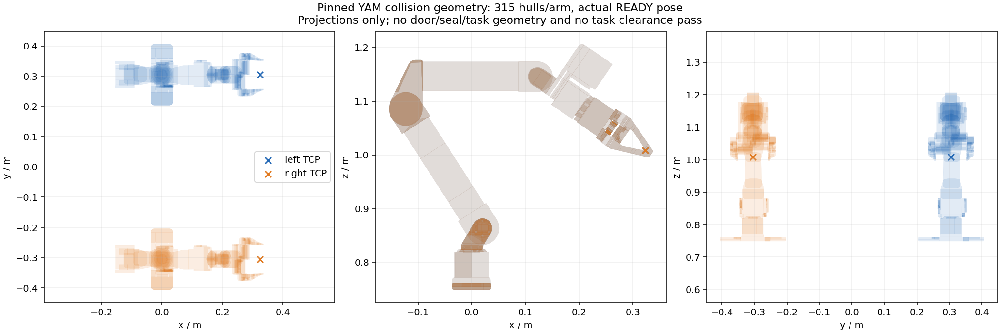

# Reproduce the CPU preflight

No Isaac, MuJoCo, Dream, PyBullet, CUDA or task runtime is imported. Python 3.12, NumPy and SciPy are required; Matplotlib is only for the optional source-geometry plot. The existing environment supplied these packages. Geometry data are derived from the pinned public YAM asset under its included MIT notice; no manufacturer manual is redistributed.

```bash
python research/robocurve-acceptance/preflight/RUN_PREFLIGHT.py
```

For the committed null/source-gap inputs, the runner expects the 20 numerical controls to pass and each candidate access program to exit **2** (`BLOCKED_MISSING_INPUTS`). The runner's exit0 means that those recorded statuses were reproduced, **not** that a candidate passed. Individual programs:

```bash
python research/robocurve-acceptance/preflight/N040_ACCESS_TEST.py
python research/robocurve-acceptance/preflight/N044_ACCESS_TEST.py
python research/robocurve-acceptance/preflight/N047_ACCESS_TEST.py
python research/robocurve-acceptance/preflight/N022_ACCESS_TEST.py
```

Use `--input FILE --output FILE` for a separately reviewed dataset. `inputs/*.json` name every required geometry/force input, normal procedure phase and site-inventory obligation. Unknown geometry stays null; guessed/unsourced values do not clear input checks. Future geometry requires declared source/measurement provenance, actual two-arm coordinates, fixed obstacle convex hulls and conservative tool/panel/payload sweep envelopes. Merely writing a part number or a point-TCP target is insufficient. The evaluator does not authenticate a dishonest external citation or prove that an annotated path really executes a mechanism; source review, expected contacts and dynamics remain separate.

Positive sweep returns require separating conservative interval enclosures. Endpoint collision is reported; exhausted refinement without separation is INCONCLUSIVE, never PASS. Collision results refer to the supplied CoACD/convex model, not empirically measured hardware. Whole adjacent-link pairs and the intentional finger-carriage overlap are exempted explicitly; this does not clear unintended contact elsewhere on adjacent bodies; a contact declaration cannot hide palm/wrist/arm collisions. A future clear result is labelled `PARTIAL_GEOMETRIC_CERTIFICATE_ONLY`, with force, contact and other limitations retained. It is not a finished feasibility result or GPU authorization.

To rebuild the committed collision reference from a checkout/clone containing the immutable pin:

```bash
python research/robocurve-acceptance/preflight/BUILD_YAM_REFERENCE.py --robot-repo /path/to/yam-isaac-lab-arena
python research/robocurve-acceptance/preflight/VERIFY_SOURCE_REFERENCE.py --robot-repo /path/to/yam-isaac-lab-arena
```

Pin:`0059d02a1a91bc6834c1d0846022891df0c78730`; derived asset source:`120c3c81400171174604e503943f8d1ebc891058`. The builder reads actual `yam_arm.urdf` collision hulls, joint frames/limits, mass/CoM and named configuration source files. Gzip metadata are fixed so the bundle is byte-reproducible. `assets/YAM_SOURCE_MANIFEST.json` lists each source hash. `VERIFY_SOURCE_REFERENCE.py` executes only the reviewed pinned pure NumPy/xml kinematics module in a temporary directory and compares all link transforms, with no simulator.

Optional CPU plot:

```bash
python research/robocurve-acceptance/preflight/PLOT_ROBOT_REFERENCE.py
```



[First-build decision](FIRST_BUILD_DECISION.md), [N040 mechanism/scoring](N040_MECHANISM_AND_SCORING.md), [N044 mechanism/scoring](N044_MECHANISM_AND_SCORING.md), [reserve kill check](N047_BACKUP_KILL_TEST.md). [Run manifest](results/RUN_MANIFEST.json) preserves command statuses, versions, code/input hashes and output hashes. [Source reference comparison](results/REFERENCE_FK_COMPARISON.json) is separate from candidate clearance. [New source attempts](sources/user-supplied-attempts.json) preserve all five user URLs and403s; no blocked page is claimed read.
